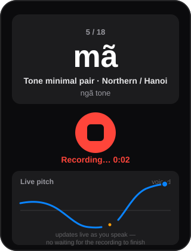
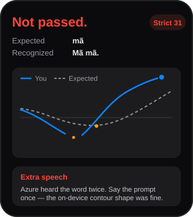
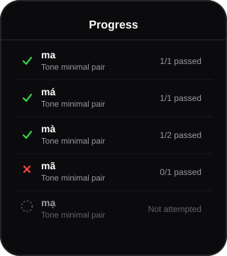

# Vavy

A strict, native iOS pronunciation tutor for Vietnamese. Not a flashcard app, not a speech-to-text demo — it shows you a word, listens to your attempt, and tells you exactly what was wrong: tone, vowel, initial or final consonant, or audio quality. No pass unless the pronunciation was actually strict enough.

```
mã
ngã tone · Northern / Hanoi

[ Listen ]  [ Record ]

→ Not passed. Recognized correctly, but the tone
  was not strict enough.
```

## What makes this different

- **Strict, not encouraging.** A high-level score alone is never the verdict — every result names the specific problem (tone, vowel, consonant, completeness, audio quality) and gives a corrective drill.
- **Two independent signals agree before you pass.** [Azure Pronunciation Assessment](https://learn.microsoft.com/en-us/azure/ai-services/speech-service/how-to-pronunciation-assessment) runs server-side; a rule-based DSP pitch analyzer runs **on-device**, right after you stop recording, and both have to line up on tone before the app calls it a pass.
- **You watch your own pitch while you speak.** Not a static waveform after the fact — a live, scrolling contour that tracks your voice in real time.

## Live pitch trace

`AVAudioEngine` taps the microphone buffer directly, runs a YIN-style pitch estimate per 40&nbsp;ms frame (5&nbsp;ms hop) while you're still talking, and plots it — speaker-normalized to semitones so it's shape, not absolute pitch, that matters.



## Expected vs. actual, after you stop

Once the recording ends, the same pitch data is quintile-summarized into a 5-point contour and compared against the tone's expected shape. Gaps are drawn as gaps, not zeros — a glottal break mid-syllable is a real feature of ngã and nặng, not missing data.



## Per-item progress

Every graded attempt (pass or not-passed — audio-quality retries don't count) is kept locally per lesson item, so you can see where you actually stand across the full tone set instead of just your last attempt.



## Architecture

```
Vavy/
  App/                    App entry point
  Features/
    Lesson/                Prompt display, lesson flow, per-item progress
    Recording/              Recording UI, live pitch view
    Evaluation/              Pass/fail feedback, contour chart
  Core/
    Audio/                  AVAudioEngine recording, YIN pitch estimator,
                             on-device tone classifier, audio quality checks
    Networking/             Multipart upload to the backend
    Models/                 Training items, assessment results
    Data/                   Starter lesson content, local progress history
    Debug/                  Debug-only request/response log (DEBUG builds)
```

The iOS app never talks to Azure directly and holds no Azure credentials — it uploads a recording plus its own on-device tone analysis to a Node.js backend, which owns Azure evaluation and the final pass/fail decision. On-device analysis can **rescue** a pass when Azure's transcription mangles a tone diacritic it clearly heard correctly; it never single-handedly fails an attempt Azure corroborated, because hỏi and ngã are phonetically merged for many speakers and no on-device heuristic fixes that. See `CLAUDE.md` and `PROJECT_SUMMARY.md` for the full decision rule and rationale.

## Running it

1. Open `Vavy.xcodeproj` in Xcode and run the `Vavy` scheme.
2. By default the app talks to the deployed backend at `https://vavy-backend.vercel.app`. To use a local backend instead (see the `vavy-backend` repo), enter its URL in the in-app backend field of a `DEBUG` build — bare tunnel hosts like `abc123.ngrok-free.app` are normalized automatically.
3. `localhost` reaches your Mac from the simulator; a physical iPhone needs your Mac's LAN IP or a tunnel URL instead.
4. Tap the mic, say the prompt, tap stop. The app checks audio quality and runs on-device tone analysis locally before uploading anything.

## Status

Static UI, recording, backend upload, real Azure-backed evaluation, live pitch trace, contour comparison, and per-item progress are all in. Not yet built: Anki/CSV import (intentionally deferred — see `CLAUDE.md`), authentication, and anything beyond the hardcoded starter lesson set.
